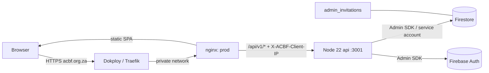

# Awards voting API operations (Dokploy)

How the voting/invitation backend runs on the existing Dokploy Compose deployment
instead of Firebase Cloud Functions. Companion to
`docs/superpowers/specs/2026-11-13-dokploy-voting-api-design.md` and
`docs/superpowers/plans/2026-11-13-dokploy-voting-api.md`.

**Approval:** Theo approves merge, deployment and opening voting. On 13 November
2026 Theo explicitly authorized Firebase preparation: dedicated IAM account/key,
closed catalogue import, admin-roster check and additive voting-only rules. Those
steps are complete. No merge, Dokploy deploy or opening was authorized/executed.

**No Blaze plan, no function deploy.** `firebase deploy --only functions` is not
part of this release. Firestore security rules are still published separately.

---

## 1. What runs where



| Component | Composes as | Public? | Notes |
|---|---|---|---|
| Frontend | `prod` (nginx, port 80) | yes, via Traefik | Serves the SPA and proxies `/api/` |
| Voting API | `api` (Node 22, port 3001) | **no published port** | Reachable only from the Compose network, via the stack-unique `acbf-voting-api` alias |
| Data | Firestore + Firebase Auth | n/a | Existing project, existing rules |

Endpoints (all JSON; `{data}` on success, `{error:{code,message}}` on failure):

| Method | Path | Purpose |
|---|---|---|
| `POST` | `/api/v1/awards/vote` | Record one vote (existing `VoteInput`) |
| `POST` | `/api/v1/admin/invitations/lookup` | Sanitized invitation for `{token}` |
| `POST` | `/api/v1/admin/invitations/accept` | Provision admin from `{token,password,name}` |
| `GET` | `/api/v1/health` | Process liveness only |
| `GET` | `/api/v1/ready` | Credentials + project + a real Firestore read |

`/api/v1/health` never reports credentials or project identity. `/api/v1/ready`
returns `503` when the credential file, project binding or Firestore access is
broken — publish a monitor against it during launch.

---

## 2. Runtime configuration

Set these in the Dokploy environment for the Compose stack (or in a `.env` file on
the deployment server, which is not committed):

| Variable | Consumed by | Example | Required |
|---|---|---|---|
| `VITE_FIREBASE_*` (6 values) | `prod` build args | — | yes |
| `FIREBASE_PROJECT_ID` | `api` | `acbf-rsa-backend` | yes |
| `PUBLIC_ORIGIN` | `api` | `https://acbf.org.za` | yes |
| `FIREBASE_ADMIN_CREDENTIALS_BASE64` | `api` runtime only | private base64 service-account JSON | yes |
| `ACBF_TRUSTED_PROXY_CIDR` | `prod` (nginx) | `10.0.5.0/24` | yes |

Rules the API enforces on startup (a failure exits non-zero and the container
restarts; nothing is served):

- `FIREBASE_PROJECT_ID` must be a valid project id and must equal the credential
  credential's `project_id`.
- `PUBLIC_ORIGIN` must be one bare origin (no path, query, fragment, wildcard).
  Mutating requests whose `Origin` differs get `403`.
- The runtime credential must decode as JSON, be
  `"type": "service_account"`, and contain `project_id`, `client_email` and
  `private_key`.
- `ACBF_TRUSTED_PROXY_CIDR` must be the *private network of the platform proxy*
  (the network Traefik/Dokploy uses to reach the `prod` container). Never
  `0.0.0.0/0`, and never a range that includes untrusted hosts.

Missing configuration is a deliberate hard failure — it is better to serve a JSON
`503` than to look like voting works.

---

## 3. Credential setup and prepared environment

A dedicated `acbf-voting-api` account has been created in `acbf-rsa-backend` with
only `roles/datastore.user` and `roles/firebaseauth.admin`. These are project-level
roles, not collection-scoped grants. The backend remains responsible for
restricting which operations callers can perform.

The owner-authorized credential is prepared in the workspace's private `.env` as
`FIREBASE_ADMIN_CREDENTIALS_BASE64`. It is **not encrypted** by base64; treat the
whole `.env` as a production secret. Compose passes this value to the **api
runtime only**, never frontend build arguments or the prod container. The API
loads the decoded credential in memory. No separate remote key upload or volume
mount is needed for this Compose configuration.

1. Copy the prepared private `.env` values to this Compose stack's **Environment**
   editor in Dokploy. Do not paste its contents into chat, Git, build arguments,
   tickets or screenshots. Review existing settings before replacing them.
2. Keep `FIREBASE_PROJECT_ID=acbf-rsa-backend` and
   `PUBLIC_ORIGIN=https://acbf.org.za` (change the latter only if the actual
   canonical browser origin differs).
3. Set `ACBF_TRUSTED_PROXY_CIDR` to the real private Traefik/Dokploy proxy network.
   It is deliberately blank in the prepared file; see section 4. Saving environment
   variables alone is not launch approval, and the blank value deliberately blocks
   deployment until filled.
4. Before merge, confirm settings are saved. On the approved Compose release,
   nginx and the API start from the same deployment. Verify readiness afterward.

A read-only `GOOGLE_APPLICATION_CREDENTIALS` file is still supported for standalone
API deployments. Supply **exactly one** source: that path or the base64 runtime
variable. This Compose uses the environment source, without a key-file mount.

The supplied broader Firebase Admin SDK key was moved outside the repository to
`/home/deploy/.config/acbf-release/supplied-firebase-admin.json` for authorized
maintenance. The dedicated API key is kept separately in that protected directory.
Neither key was committed. The broader key is not used in the Dokploy environment.

**Rotation:** create a replacement dedicated key, replace the base64 runtime value
in Dokploy, recreate the API container through an approved deployment, confirm
readiness, then revoke the previous dedicated key. Do not revoke the separately
supplied maintenance key without identifying its other uses.

---

## 4. Proxy trust (launch gate)

The per-network vote ceiling is keyed by the client address. nginx is the only
component that learns it, and it forwards exactly one header:

```nginx
proxy_set_header X-ACBF-Client-IP $remote_addr;   # overwrites browser input
```

The API ignores `X-Forwarded-For`, `Forwarded` and every other forwarding header.
`$remote_addr` is the browser only if nginx trusts the platform proxy and reads
Cloudflare's `CF-Connecting-IP` (`set_real_ip_from $ACBF_TRUSTED_PROXY_CIDR;
real_ip_header CF-Connecting-IP`). `X-Forwarded-For` is not used: Docker rewrites
inbound connections to the proxy bridge gateway, so it never holds the visitor.
This assumes public traffic arrives through Cloudflare.

Verify before opening voting, from a network whose public IP you know:

1. `docker compose config --quiet` renders and both containers are healthy:

   ```bash
   docker compose ps
   curl -s https://acbf.org.za/api/v1/health   # {"data":{"status":"ok"}}
   curl -s https://acbf.org.za/api/v1/ready    # {"data":{"status":"ready"}}
   ```

2. Make a request and read nginx's access log (its first field is `$remote_addr`
   *after* real-IP resolution):

   ```bash
   curl -s -o /dev/null https://acbf.org.za/api/v1/health
   docker compose logs --tail 20 prod
   ```

   The logged address must be your public IP. If it is a private container
   address, `ACBF_TRUSTED_PROXY_CIDR` is wrong — do not open voting.

3. Forge a header and confirm it changes nothing (the logged address stays your
   real IP; the vote, if submitted, is attributed to that IP):

   ```bash
   curl -s -o /dev/null -H 'X-Forwarded-For: 198.51.100.9' \
        -H 'X-ACBF-Client-IP: 198.51.100.9' https://acbf.org.za/api/v1/health
   docker compose logs --tail 5 prod
   ```

4. If Dokploy's proxy network cannot be inspected from here, treat the exact
   CIDR as a **release blocker**, not a guess. Never widen it to `0.0.0.0/0`.

The API is not published on a host port and gets no Traefik domain label; if a
port ever appears in `docker compose ps`, remove the mapping before launch.

---

## 5. Release order

`main` auto-deploys, so credential and proxy setup must be complete **before** the
merge that ships this code.

1. **Provision** the service account/runtime secret (§3), set all environment variables
   (§2), confirm `ACBF_TRUSTED_PROXY_CIDR` (§4).
2. **Authorize and merge** the PR. Dokploy rebuilds `prod` and `api`.
3. **Publish Firestore rules** (unchanged boundary, still required):

   ```bash
   firebase deploy --only firestore:rules
   ```

   Do **not** run `firebase deploy --only functions`.
4. **Import the catalogue** while voting stays closed (owner-run, private file):

   ```bash
   node scripts/awards/import-nominees.mjs "$HOME/private/Awards Nominees 5.xlsx" \
     --apply --project acbf-rsa-backend
   ```

   The importer creates `award_competitions/2026` closed only when it is absent
   and never writes votes, totals or rate-limit buckets.
5. **Validate the admin roster** before opening: `approved_admins` must contain
   `chinomonatinotenda19@gmail.com` and every current admin with
   `status: 'approved'`; `users/{uid}.role` stays display metadata.
6. **Smoke checks** (§6).
7. **Open voting** only on Theo's launch approval by setting
   `award_competitions/2026` to `{isOpen: true, closesAt: <2026-11-19T14:00:00Z>}`.
   The flag can never extend the deadline.

---

## 6. Smoke checks after deploy (voting still closed)

- `GET /api/v1/health` → `{"data":{"status":"ok"}}`.
- `GET /api/v1/ready` → `{"data":{"status":"ready"}}`.
- `POST /api/v1/awards/vote` with a valid body → `409`/`failed-precondition`
  ("Voting is not open…"), **not** `200`, not HTML.
- A vote request with the proxy header removed at the API (for example by
  temporarily running the container without nginx) → JSON `503`, never a vote.
- `GET https://acbf.org.za/awards` loads; `/api/v1/does-not-exist` returns JSON
  `404`; killing the `api` container returns JSON `503` on `/api/v1/health` while
  the marketing pages keep serving.
- As an admin, **Voting Results** lists the imported nominees at zero and
  **Nomination Archive** still lists historical nominations.
- Invitation acceptance: open an existing pending invitation link, confirm the
  invitation summary loads, complete acceptance, then sign in. A used, cancelled
  or expired token must be refused with a readable message.
- Contact and membership form submissions still succeed (their email triggers are
  unchanged and out of scope).

---

## 7. Monitoring and incidents

| Symptom | Likely cause | Action |
|---|---|---|
| `/api/v1/health` 503 through nginx | `api` not running or unreachable | `docker compose ps`, `docker compose logs api` |
| `/api/v1/ready` 503, health 200 | bad/missing credentials, wrong project, Firestore unreachable | logs show `readiness check failed`; verify §2/§3, recreate `api` |
| `api` restarts immediately | credential/config error | `docker compose logs api` — the message names the variable, never its value |
| `/api/*` returns JSON 503 while `api` is healthy | nginx resolved the generic `api` alias on the shared `dokploy-network` to another stack's container | proxy must use `acbf-voting-api`; verify with `docker exec <prod> getent hosts acbf-voting-api` |
| Mutations return `403` | `Origin` ≠ `PUBLIC_ORIGIN` | fix the variable (bare origin), recreate `api` |
| Votes return `503` but health is fine | nginx is not setting `X-ACBF-Client-IP` | check the `prod` config and §4 |
| Everything returns 502/503 after a redeploy | nginx cached an old `api` address | the config resolves `api` per request via Docker DNS; reload `prod` if it persists |
| Whole site down instead of a voting-only 503 | `prod` was gated on `api` being healthy | keep `condition: service_started` (startup ordering only) — readiness belongs to `/api/v1/ready`, not container gating |

Never paste credential JSON, request bodies, passwords or invitation tokens into
tickets or logs. The API logs only the failing error's name/code.

---

## 8. Backups and rollback

### Backups before launch

Capture read-only copies of `award_competitions/2026` (the competition document
plus the `categories`, `nominees`, `totals` and `votes` subcollections),
`approved_admins` and `admin_invitations` from the Firebase console before opening
voting, and again before any catalogue re-import. Firestore managed backups or
`gcloud firestore export` depend on the project's plan and billing, and billing is
currently disabled — do not assume either exists. The importer is idempotent and
never writes votes or totals, so recovery from a bad deploy is a code rollback,
not a data restore.

### Rollback

1. **Close voting first**: set `award_competitions/2026.isOpen` to `false`.
2. Do not delete votes, totals, nominees or rate-limit buckets; a rollback never
   needs a data reset.
3. Redeploy the previous green commit through Dokploy. Both images rebuild from
   the repository; the API image contains only `functions/src/{api,awards,admin}`
   and `functions/src/errors.js`.
4. If the API cannot start, the frontend keeps serving and voting returns JSON
   `503` — that is the intended degraded state. Fix or roll back, then confirm
   `/api/v1/ready` before reopening.
5. If a credential is suspected compromised: revoke the key, close voting, rotate
   (§3), and report the timeline.

---

## 9. Out of scope

- Deploying or deleting Firebase Functions; the callable exports remain only as
  compatibility adapters for tests and rollback.
- Email triggers (`onContactSubmissionCreated`,
  `onMembershipApplicationCreated`, `testEmail`) and SMTP credentials.
- Public vote totals, leaderboards, paid voting, vote editing.
- PostgreSQL or any new datastore.
- Brand assets, legacy PHP endpoints and `src/lib/firebase.js` credentials.

## SQLite vote store (replaces Firestore for voting)

When `AWARDS_STORE_PATH` is set (Compose sets `/data/awards.sqlite`), votes,
deduplication and hourly rate limits live in SQLite on the `awards-data` volume,
so voting no longer depends on Firestore quota. The ballot reads its catalogue
from `GET /api/v1/awards/catalogue`, served from `/data/catalogue.json`.

**One-time load (needs Firestore to answer, so after a quota reset or on Blaze):**

```bash
docker exec <api-container> node src/awards/exportFromFirestore.js
```

By default it imports only the votes already recorded in Firestore (idempotent:
re-running never double counts) and leaves the catalogue file alone. Add
`--catalogue` to overwrite the catalogue from Firestore. Until the snapshot exists the API
answers `503` for votes and the catalogue, and `/api/v1/ready` reports not ready.


**Totals** are derived from the votes table:

```bash
docker exec <api-container> node -e "const {createSqliteVoteStore,createCatalogueSource}=require('./src/awards/sqliteStore');const s=createSqliteVoteStore({path:process.env.AWARDS_STORE_PATH,catalogue:createCatalogueSource(process.env.AWARDS_CATALOGUE_PATH)});console.table(s.totals())"
```

The admin results panel still reads Firestore totals and will not show votes
recorded in SQLite. **Back up** with `VACUUM INTO` (a plain `docker cp` of `awards.sqlite` misses
votes still in the `-wal` file and produces an empty backup) and never delete the
`awards-data` volume while voting is open.

### Admin results from SQLite

The admin results panel reads `GET /api/v1/admin/awards/results`, which returns
per-nominee totals (never voter details) from the SQLite store. The caller's
Firebase sign-in token is verified in the API, and the email must appear in
`AWARDS_ADMIN_EMAILS` (comma-separated, set in Dokploy). This does not read
Firestore, so it works while Firestore is unavailable. If the variable is empty,
every caller gets `403`. After changing it, redeploy `api`.

### Rebuilding the catalogue from the workbook

```bash
node scripts/awards/build-catalogue.mjs "Awards Nominees 5.xlsx" catalogue.json --open
```

The script re-applies the committee's edits (Theo.docx) and the 14 November
correction, keyed by stable nominee id. Load the result with `docker exec -i
<api> sh -c 'cat > /data/catalogue.json'`. Do not run `exportFromFirestore.js`
for the catalogue unless the same edits exist in Firestore: it overwrites the file.

### Form notification emails (Resend)

The contact and membership forms save to Firestore, then call
`POST /api/v1/notify/contact` and `/api/v1/notify/membership`, which email the
admin through Resend. Set `RESEND_API_KEY`, `RESEND_FROM` (a sender on a domain
verified in Resend) and `NOTIFY_TO` in Dokploy. Without them the endpoints answer
`503` and log `email notifications disabled` at startup. The recipient is fixed
server-side; each network is limited to 5 messages an hour per form.
