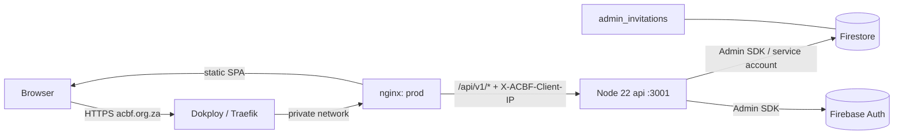

# Awards voting API operations (Dokploy)

How the voting/invitation backend runs on the existing Dokploy Compose deployment
instead of Firebase Cloud Functions. Companion to
`docs/superpowers/specs/2026-11-13-dokploy-voting-api-design.md` and
`docs/superpowers/plans/2026-11-13-dokploy-voting-api.md`.

**Approval:** Theo approves the merge, the deployment and opening voting. Nothing
here may be executed against production by an implementing agent.

**No Blaze plan, no function deploy.** `firebase deploy --only functions` is not
part of this release. Firestore security rules are still published separately.

---

## 1. What runs where



| Component | Composes as | Public? | Notes |
|---|---|---|---|
| Frontend | `prod` (nginx, port 80) | yes, via Traefik | Serves the SPA and proxies `/api/` |
| Voting API | `api` (Node 22, port 3001) | **no published port** | Only reachable from the Compose network |
| Data | Firestore + Firebase Auth | n/a | Existing project, existing rules |

Endpoints (all JSON; `{data}` on success, `{error:{code,message}}` on failure):

| Method | Path | Purpose |
|---|---|---|
| `POST` | `/api/v1/awards/vote` | Record one vote (existing `VoteInput`) |
| `POST` | `/api/v1/admin/invitations/lookup` | Sanitized invitation for `{token}` |
| `POST` | `/api/v1/admin/invitations/accept` | Provision admin from `{token,password,name}` |
| `GET` | `/api/v1/health` | Process liveness only |
| `GET` | `/api/v1/ready` | Credentials + project + a real Firestore read |

`/api/v1/health` never reports credentials or project identity. `/api/v1/ready`
returns `503` when the credential file, project binding or Firestore access is
broken — publish a monitor against it during launch.

---

## 2. Runtime configuration

Set these in the Dokploy environment for the Compose stack (or in a `.env` file on
the deployment server, which is not committed):

| Variable | Consumed by | Example | Required |
|---|---|---|---|
| `VITE_FIREBASE_*` (6 values) | `prod` build args | — | yes |
| `FIREBASE_PROJECT_ID` | `api` | `acbf-rsa-backend` | yes |
| `PUBLIC_ORIGIN` | `api` | `https://acbf.org.za` | yes |
| `FIREBASE_ADMIN_CREDENTIALS_FILE` | Compose volume | `/opt/acbf/secrets/firebase-admin.json` | yes |
| `ACBF_TRUSTED_PROXY_CIDR` | `prod` (nginx) | `10.0.5.0/24` | yes |

Rules the API enforces on startup (a failure exits non-zero and the container
restarts; nothing is served):

- `FIREBASE_PROJECT_ID` must be a valid project id and must equal the credential
  file's `project_id`.
- `PUBLIC_ORIGIN` must be one bare origin (no path, query, fragment, wildcard).
  Mutating requests whose `Origin` differs get `403`.
- The credential file must exist, be readable, parse as JSON, be
  `"type": "service_account"`, and contain `project_id`, `client_email` and
  `private_key`.
- `ACBF_TRUSTED_PROXY_CIDR` must be the *private network of the platform proxy*
  (the network Traefik/Dokploy uses to reach the `prod` container). Never
  `0.0.0.0/0`, and never a range that includes untrusted hosts.

Missing configuration is a deliberate hard failure — it is better to serve a JSON
`503` than to look like voting works.

---

## 3. Credential setup (requires Theo's authorization)

Do not create or download service-account keys, and do not change IAM, without
explicit authorization. Interactive `firebase login` tokens are **not** acceptable
server credentials.

1. In the Firebase project (`acbf-rsa-backend`) create a dedicated service
   account, e.g. `acbf-voting-api`, owned by the project.
2. Grant only the roles these endpoints need:
   - **Cloud Datastore User** (`roles/datastore.user`) — read/write
     `award_competitions/**`, `users/{uid}`, `approved_admins/**`,
     `admin_invitations/**`.
   - **Firebase Authentication Admin** (`roles/firebaseauth.admin`) — create the
     Auth user during invitation acceptance and delete it if the profile write
     fails.
   - No roles for Storage, Cloud Functions, billing or project administration.
3. Create one JSON key for that account (authorized step). Treat the file as a
   production secret: never commit it, never place it in the repository, never
   pass it through a Vite variable, never paste it into logs or tickets.
4. Place it on the Dokploy deployment server outside the repository, e.g.
   `/opt/acbf/secrets/firebase-admin.json`:

   ```bash
   sudo install -d -m 0750 -o root -g root /opt/acbf/secrets
   sudo install -m 0400 -o 1000 -g 1000 \
     /path/to/downloaded-key.json /opt/acbf/secrets/firebase-admin.json
   sudo ls -l /opt/acbf/secrets/firebase-admin.json
   # -r-------- 1 1000 1000 ... firebase-admin.json
   ```

   `FIREBASE_ADMIN_CREDENTIALS_FILE` only names this host path; Compose does not
   create the file. The container runs as uid 1000 (`node`), so the file must be
   readable by that uid. Docker bind-mounts also require the *path itself* to be
   present before `docker compose up`.
5. Set `FIREBASE_ADMIN_CREDENTIALS_FILE=/opt/acbf/secrets/firebase-admin.json` in
   the stack environment. Compose mounts it at
   `/run/secrets/firebase-admin.json:ro` and sets
   `GOOGLE_APPLICATION_CREDENTIALS` to that path.

**Rotation:** create the replacement key, install it over the path above with the
same ownership, then `docker compose up -d --force-recreate api`. Delete the old
key in the console after `/api/v1/ready` returns `200`.

---

## 4. Proxy trust (launch gate)

The per-network vote ceiling is keyed by the client address. nginx is the only
component that learns it, and it forwards exactly one header:

```nginx
proxy_set_header X-ACBF-Client-IP $remote_addr;   # overwrites browser input
```

The API ignores `X-Forwarded-For`, `Forwarded` and every other forwarding header.
`$remote_addr` is the browser only if nginx trusts the platform proxy's
`X-Forwarded-For` (`set_real_ip_from $ACBF_TRUSTED_PROXY_CIDR`).

Verify before opening voting, from a network whose public IP you know:

1. `docker compose config` renders and both containers are healthy:

   ```bash
   docker compose ps
   curl -s https://acbf.org.za/api/v1/health   # {"data":{"status":"ok"}}
   curl -s https://acbf.org.za/api/v1/ready    # {"data":{"status":"ready"}}
   ```

2. Make a request and read nginx's access log (its first field is `$remote_addr`
   *after* real-IP resolution):

   ```bash
   curl -s -o /dev/null https://acbf.org.za/api/v1/health
   docker compose logs --tail 20 prod
   ```

   The logged address must be your public IP. If it is a private container
   address, `ACBF_TRUSTED_PROXY_CIDR` is wrong — do not open voting.

3. Forge a header and confirm it changes nothing (the logged address stays your
   real IP; the vote, if submitted, is attributed to that IP):

   ```bash
   curl -s -o /dev/null -H 'X-Forwarded-For: 198.51.100.9' \
        -H 'X-ACBF-Client-IP: 198.51.100.9' https://acbf.org.za/api/v1/health
   docker compose logs --tail 5 prod
   ```

4. If Dokploy's proxy network cannot be inspected from here, treat the exact
   CIDR as a **release blocker**, not a guess. Never widen it to `0.0.0.0/0`.

The API is not published on a host port and gets no Traefik domain label; if a
port ever appears in `docker compose ps`, remove the mapping before launch.

---

## 5. Release order

`main` auto-deploys, so credential and proxy setup must be complete **before** the
merge that ships this code.

1. **Provision** the service account and file (§3), set all environment variables
   (§2), confirm `ACBF_TRUSTED_PROXY_CIDR` (§4).
2. **Authorize and merge** the PR. Dokploy rebuilds `prod` and `api`.
3. **Publish Firestore rules** (unchanged boundary, still required):

   ```bash
   firebase deploy --only firestore:rules
   ```

   Do **not** run `firebase deploy --only functions`.
4. **Import the catalogue** while voting stays closed (owner-run, private file):

   ```bash
   node scripts/awards/import-nominees.mjs "$HOME/private/Awards Nominees 5.xlsx" \
     --apply --project acbf-rsa-backend
   ```

   The importer creates `award_competitions/2026` closed only when it is absent
   and never writes votes, totals or rate-limit buckets.
5. **Validate the admin roster** before opening: `approved_admins` must contain
   `chinomonatinotenda19@gmail.com` and every current admin with
   `status: 'approved'`; `users/{uid}.role` stays display metadata.
6. **Smoke checks** (§6).
7. **Open voting** only on Theo's launch approval by setting
   `award_competitions/2026` to `{isOpen: true, closesAt: <2026-11-19T14:00:00Z>}`.
   The flag can never extend the deadline.

---

## 6. Smoke checks after deploy (voting still closed)

- `GET /api/v1/health` → `{"data":{"status":"ok"}}`.
- `GET /api/v1/ready` → `{"data":{"status":"ready"}}`.
- `POST /api/v1/awards/vote` with a valid body → `409`/`failed-precondition`
  ("Voting is not open…"), **not** `200`, not HTML.
- A vote request with the proxy header removed at the API (for example by
  temporarily running the container without nginx) → JSON `503`, never a vote.
- `GET https://acbf.org.za/awards` loads; `/api/v1/does-not-exist` returns JSON
  `404`; killing the `api` container returns JSON `503` on `/api/v1/health` while
  the marketing pages keep serving.
- As an admin, **Voting Results** lists the imported nominees at zero and
  **Nomination Archive** still lists historical nominations.
- Invitation acceptance: open an existing pending invitation link, confirm the
  invitation summary loads, complete acceptance, then sign in. A used, cancelled
  or expired token must be refused with a readable message.
- Contact and membership form submissions still succeed (their email triggers are
  unchanged and out of scope).

---

## 7. Monitoring and incidents

| Symptom | Likely cause | Action |
|---|---|---|
| `/api/v1/health` 503 through nginx | `api` not running or unreachable | `docker compose ps`, `docker compose logs api` |
| `/api/v1/ready` 503, health 200 | bad/missing credentials, wrong project, Firestore unreachable | logs show `readiness check failed`; verify §2/§3, recreate `api` |
| `api` restarts immediately | credential/config error | `docker compose logs api` — the message names the variable, never its value |
| Mutations return `403` | `Origin` ≠ `PUBLIC_ORIGIN` | fix the variable (bare origin), recreate `api` |
| Votes return `503` but health is fine | nginx is not setting `X-ACBF-Client-IP` | check the `prod` config and §4 |
| Everything returns 502/503 after a redeploy | nginx cached an old `api` address | the config resolves `api` per request via Docker DNS; reload `prod` if it persists |

Never paste credential JSON, request bodies, passwords or invitation tokens into
tickets or logs. The API logs only the failing error's name/code.

---

## 8. Rollback

1. **Close voting first**: set `award_competitions/2026.isOpen` to `false`.
2. Do not delete votes, totals, nominees or rate-limit buckets; a rollback never
   needs a data reset.
3. Redeploy the previous green commit through Dokploy. Both images rebuild from
   the repository; the API image contains only `functions/src/{api,awards,admin}`
   and `functions/src/errors.js`.
4. If the API cannot start, the frontend keeps serving and voting returns JSON
   `503` — that is the intended degraded state. Fix or roll back, then confirm
   `/api/v1/ready` before reopening.
5. If a credential is suspected compromised: revoke the key, close voting, rotate
   (§3), and report the timeline.

---

## 9. Out of scope

- Deploying or deleting Firebase Functions; the callable exports remain only as
  compatibility adapters for tests and rollback.
- Email triggers (`onContactSubmissionCreated`,
  `onMembershipApplicationCreated`, `testEmail`) and SMTP credentials.
- Public vote totals, leaderboards, paid voting, vote editing.
- PostgreSQL or any new datastore.
- Brand assets, legacy PHP endpoints and `src/lib/firebase.js` credentials.
